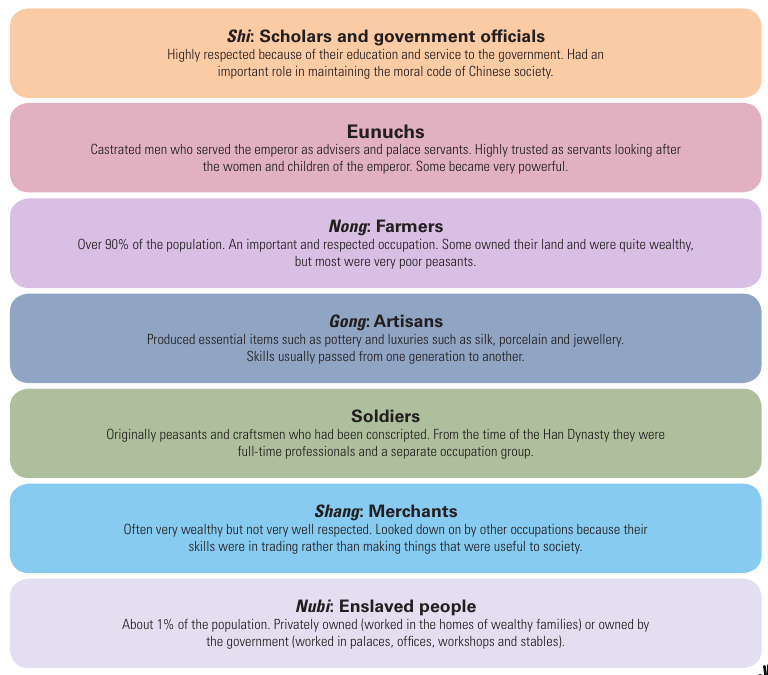

#+TITLE: Ancient China Notes
#+AUTHOR: Justin Guo

Depth Study 2: The Asian World – “Walls and Warriors”

* Explain how the geography and natural features of ancient China impacted its development.

** Rivers
China has many rivers and fertile valleys.
Most nobtably:
- Yellow (Huang) River
- Yangtze (Chang Jiang) River

Between these rivers are exeptionally fertile plains
Early Chinese societies were built around these Rivers, Valleys, and Plains.

Crops such as
- Maize
- Sorghum
were grown in the North around the Yellow River.

The most commonly grown crop around the Yangtze, was rice, due its higher rainfall and warmer weather.
The area around these two rivers is known as China's cradle of civilisation.
However the Yellow River is also known as 'China's sorrow' as it regularly flooded, causing devastation to surrounding areas.
However, due to the flooding, stronger states developed to control flooding, eventually leading to an empire.

** Mountains
Through the center of China, runs the Qinling mountains, seperating North and South significantly affecting the future events of China.

In the North and South-West are large mountain ranges including
- The Himalayas
- The Tibetan Plateau
- The Altai Mountains
- Mongolian Plateau
Providing physical barriers for China to take advantage of
Dense tropical forests also provided barriers between China and Southern civilisations such as Vietname, Laos, and Myanmar.

Due to this isolation, China developed a unique culture, and the early Chinese thrived because of their ability to produce food effortlessly.
When China eventually came into contact with other civilisations, the Chinese branded them as barbarians and the Chinese thought they were the Middle Kingdom; the center of the world.

* Describe how Chinese society was organised and administered.

** The legal system
In ancient China power was passed through generations, this is known as a dynasty.
The emperor held power over China. However, the emperor was expected to be responsible and help people.
This can be observed through the belief of the "Mandate of Heaven", stating that the emperor had divine approval.
If an emperor was cruel and ruled during a time of natural disasters, this would be seen as the "Mandate of Heaven" being stripped, providing a reason for war.
The emperor naturally, could not manage an entire empire by himself, introducing the role of officials, or the bureaucracy.
Officals were initially selected from nobel families. However, China transitioned to a system of meritocracy instead through a public examination known as the "Ke Ju"

During the Warring States period and the Qing Dynasty (~475-221 BCE). Stating that only through regulated, and comprehensive laws, can you regulate one's behaviour.

** Social Structure

1. Shi: Scholars and government officials
   - Highly respected because of their education and service to the government.
   - Had an important role in maintaining the moral code of Chinese society.
2. Eunuchs
   - Castrated men who served the emperor as advisers and palace servants.
   - Highly trusted as servants looking after the women and children of the emperor. Some became very powerful.
3. Nong: Farmers
   - Over 90% of the population. An important and respected occupation.
   - Some owned their land and were quite wealthy, but most were very poor peasants.
4. Gong: Artisans
   - Produced essential items such as pottery and luxuries such as silk, porcelain and jewellery.
   - Skills usually passed from one generation to another.
5. Soldiers
   - Originally peasants and craftsmen who had been conscripted.
   - From the time of the Han Dynasty they were full-time professionals and a separate occupation group.
6. Shang: Merchants
   - Often very wealthy but not very well respected.
   - Looked down on by other occupations because their skills were in trading rather than making things that were useful to society.
7. Nubi: Enslaved people
   - About 1% of the population.
   - Privately owned (worked in the homes of wealthy families) or owned by the government (worked in palaces, offices, workshops and stables).

