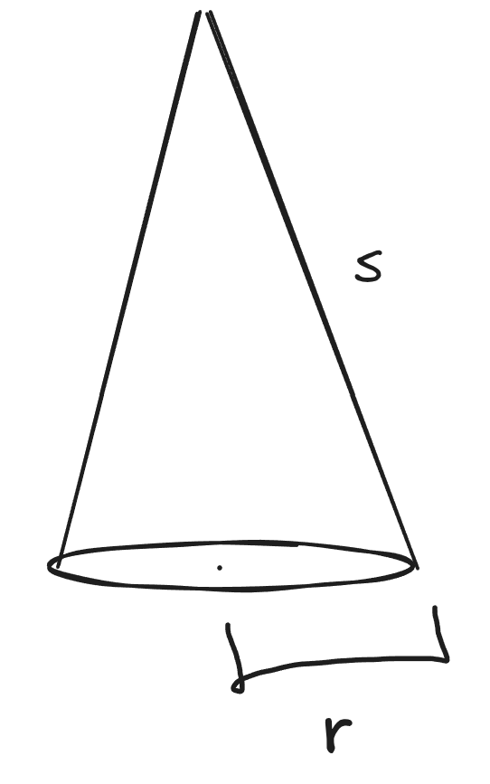
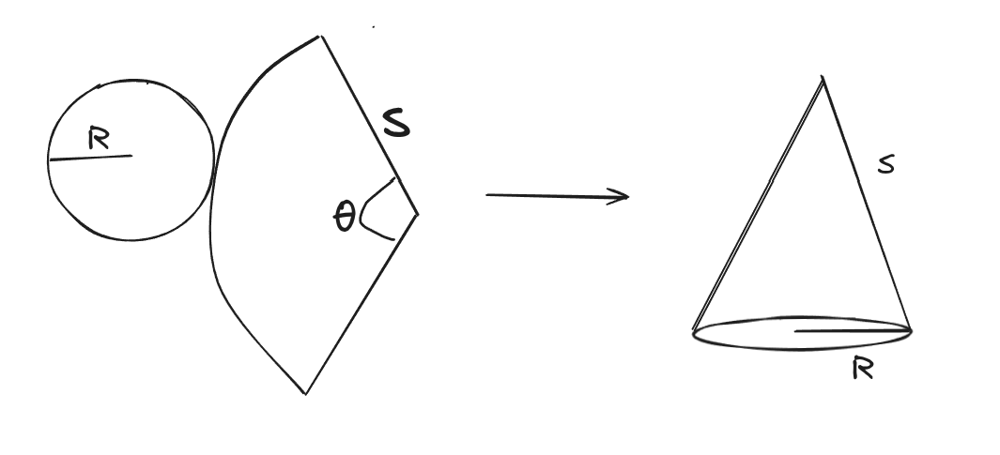

​#Maths/Geometry/3D The [[file:./Surface%20area.org][surface area]] of a
hollow cone is given by \(\pi r s\) where s is the length of the cone
and r is the radius of the base 
The reasoning is as follows: 
Arc of curved surface of cone of radius s = circumference of circle with
radius r \(\therefore {r\over s}  = {\theta \over 360}\) As the curved
surface of cone can be considered to be a sector, the calculation is the
following: \[
\begin{aligned}
{\theta \over 360} \times \pi s^2 \\
= {r \over s} \times \pi s^2 \\
= {\pi rs^2 \over s} \\
= \pi rs \\
\end{aligned}
\]

** Flashcards
:PROPERTIES:
:CUSTOM_ID: flashcards
:END:
How is the curved surface area of a cone calculated?::\(\pi rs\)
