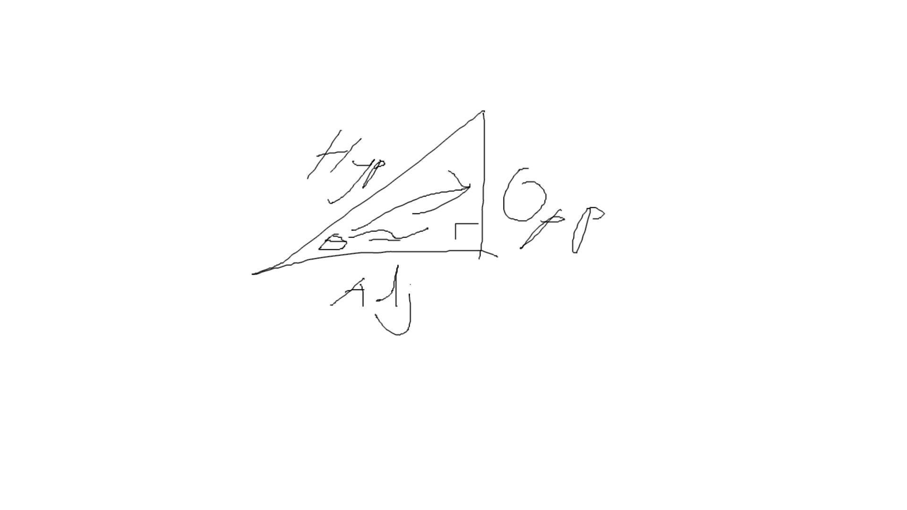

#+title: Labeling Triangles
#+author: Justin Guo

- Opp: The opposite is the side opposite to said angle theta
- Adj: The adjacent is the side adjacent to said angle theta
- Hyp: The hypotnuse is the longest side

