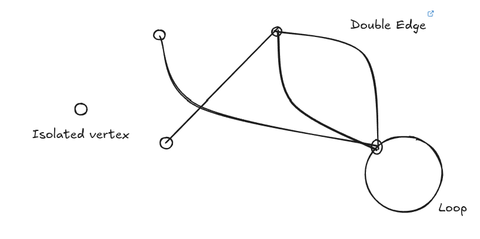
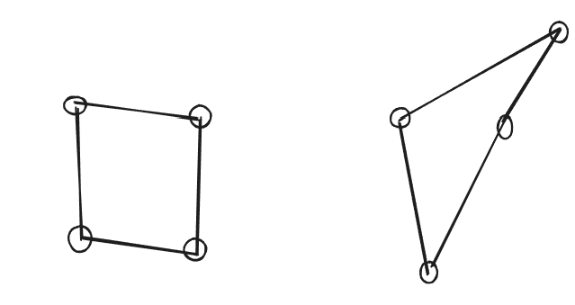
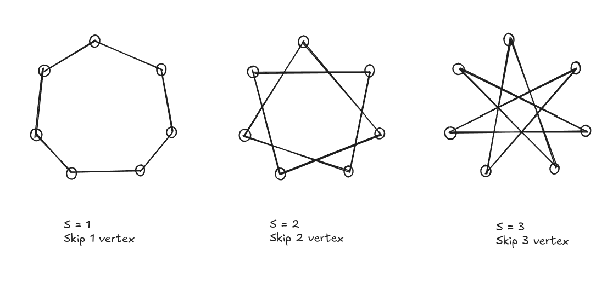
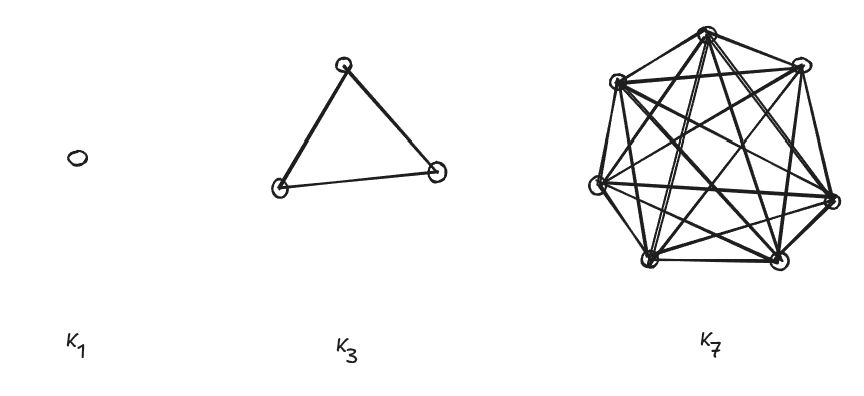
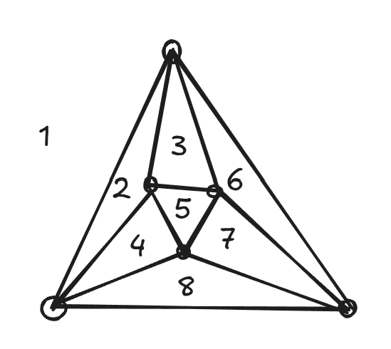

​#Maths/Geometry/GraphTheory [[file:./Graphs.org][Graphs]] represent
relationships between [[../../Geometry/3D/Objects.org][Objects]], such
as the x and y coordinates.

[Obsidian embed requires review: .
This a graph depicting multiple features of
[[file:./Edge.org][Edge]]s and [[file:./Vertices.org][Vertices]]

- The degree of a vertex is the number of [[file:./Edge.org][Edge]] ends
  attached to it (how many ways you can leave the vertex)
- A graph is connected if you can travel to all the
  [[file:./Vertices.org][Vertices]] in the graph

**** Handshaking lemma
:PROPERTIES:
:CUSTOM_ID: handshaking-lemma
:END:
Every [[file:./Edge.org][Edge]] has 2 ends. However the degrees of a
vertex counts the number of [[file:./Edge.org][Edge]] ends attached.
\(\therefore\) The sum of all degrees = 2 \(\times\) the number of edges
Otherwise the graph is not possible

** Isomorphic graphs
:PROPERTIES:
:CUSTOM_ID: isomorphic-graphs
:END:
When 2 or more graphs have the same structure (relations), they are
known as isomorphic graphs

These two are isomorphic because you can [[transform]] the square into
the second [[quadrilateral]] without changing the innate relationships
between the different [[file:./Vertices.org][Vertices]]

** Cycle graphs
:PROPERTIES:
:CUSTOM_ID: cycle-graphs
:END:
To draw a cycle graph - Place n [[file:./Vertices.org][Vertices]] around
in a circle - Pick a whole number s (the skipping number) - Join each
vertex by a single [[file:./Edge.org][Edge]] to the vertex s places to its
left

** Complete graphs
:PROPERTIES:
:CUSTOM_ID: complete-graphs
:END:
Complete [[file:./Graphs.org][Graphs]] is one in which every vertex is
connected to eachother. We use the symbol \(K~n\) to represent a
complete graph with n [[file:./Vertices.org][Vertices]]

** Planar graphs
:PROPERTIES:
:CUSTOM_ID: planar-graphs
:END:
Planar graphs are graphs that can be drawn without crossing
[[file:./Edge.org][Edge]]s. Since planar graphs don't cross
[[file:./Edge.org][Edge]]s they can be imagined as 3d
[[../../Geometry/3D/Objects.org][Objects]].

Euler's [[../../../Formula.org][Formula]] declares that for any
connected planar graph \(\because\) planar graphs can be imagined as 3d,
the [[../../../Formula.org][Formula]] \(Vertices + Faces - 2 = Edges\)
can be applied \(\therefore Vertices-Edges+Faces=2\) can be applied to
check if a graph is planar

The graph above has 8 faces, 6 [[file:./Vertices.org][Vertices]], and 12
edges \[
\begin{aligned}
V - E + F &= 2 \\
6 - 12 + 8 &= 2 \\
2 &= 2
\end{aligned}
\]

