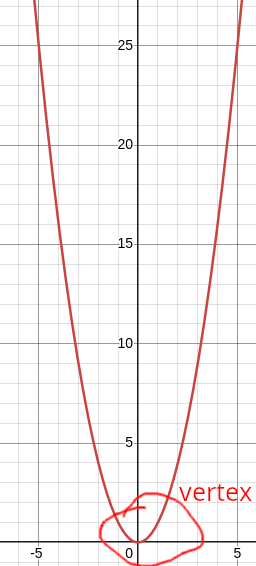

#+TITLE: Quadratic Functions
#+AUTHOR: Justin Guo

* What is a Quadratic Function
A quadratic function is a relationship between two variables which can be written in the form:
$y = ax^2+bx+c$
Where a, b, c are constants

** Graphs of Quadratic Functions
All graphs of quadratic functions are parabolas.

Features:
- Symetrical about y axis
- Has a minimum turning point at (0, 0), known as the vertex of the parabola

The minimum turning point is when a decreasing line flips and starts increasing, symetrical to line before the turning point.
The maximum turning point is when a increasing line flips and starts decreasing, symetrical to line before the turning point.

* Table of values

One way to graph a graph is to lay out a table of values following the general/y-intercept form
E.g.

y = -x
x|-3|-2|-1| 0| 1| 2| 3
y| 3| 2| 1| 0|-1|-2|-3

* Forms

** y = (x-h)*2

Graphs of the form y = (x-h)^2 + k have the same shape as the graph of y = x^2

The graph of y = x^2 is translated h units across, and k units vertically, to give the graph y = (x-h)^2 + k
The vertex of such graph is therefore (h, k)

** $y = ax^2$

The vertex of y=ax^2 is (0, 0)
If a>0, y = ax^2 opens upwards
If a<0, y = ax^2 opens downards

If |a| > 1, y = ax^2 is "thinner" than y = x^2
If |a| < 1, y = ax^2 is "wider" than y = x^2
y = -ax^2 is a reflection of y = ax^2 in the x axis

** y = a(x-alpha)(x-beta)
y = a(x-alpha)(x-beta)
has x intercepts alpha and beta

* Axes intercepts

The x intercept of a function is a value of x where its graph meets the x axis
- Found through y = 0

The y intercept of a function is a value of y where its graph meets the y axis
- Found through x = 0
