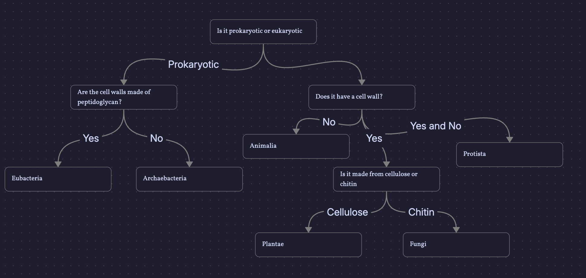

​#Science/Biology/Classification The specialisation in the classification
of living organisms is known as taxonomy

** Technique
:PROPERTIES:
:CUSTOM_ID: technique
:END:
Kingdom, Phylum, Class, Order, Family, Genus, Species

*** Kingdom
:PROPERTIES:
:CUSTOM_ID: kingdom
:END:
There are 6 main kingdoms with different characteristics - Animalia: -
Eukaryotic (contains a
[[../Atoms/Nucleus-physics.org][Nucleus-physics]]) - Multicellular
(contains multiple cells) - No cell wall - Heterotroph (consumes food) -
Motile (able to move) - Mainly sexual reproduction - Plantae: -
Eukaryotic (contains a
[[../Atoms/Nucleus-physics.org][Nucleus-physics]]) - Multicellular
(contains multiple cells) - Cell wall made of cellulose - Autotroph
(creates its own food through chemical reactions like photosynthesis) -
Non-motile (does not move) - Both sexual and asexual reproduction -
Fungi: - Eukaryotic (contains a
[[../Atoms/Nucleus-physics.org][Nucleus-physics]]) - Mostly
multicellular (contains multiple cells) - Cell wall made of chitin -
Heterotroph (consumes food) - Non-motile (does not move) - Mainly
through spores but also through sexual and asexual reproduction -
Protista: - Eukaryotic (contains a
[[../Atoms/Nucleus-physics.org][Nucleus-physics]]) - Mostly unicellular
(contains a single cell) - Some have cell walls, some don't - Some are
heterotrophs (consumes food), some are autotrophs (creates its own food
through chemical reactions like photosynthesis) - Mostly motile (able to
move) - Sexual and asexual reproduction - Eubacteria: - Prokaryotic
(does not contain a [[../Atoms/Nucleus-physics.org][Nucleus-physics]]) -
Unicellular (contains a single cell) - Most contain cell walls, cell
walls are made mostly from peptidoglycan - Some are heterotrophs
(consumes food), some are autotrophs (creates its own food through
chemical reactions like photosynthesis) - Some are motile (able to move)
and some aren't - Binary fission - Archaebacteria: - Prokaryotic (does
not contain a [[../Atoms/Nucleus-physics.org][Nucleus-physics]]) -
Unicellular (contains a single cell) - Most contain cell walls, cell
walls lack peptidoglycan - Some are heterotrophs (consumes food), some
are autotrophs (creates its own food through chemical reactions like
photosynthesis) - Some are motile (able to move) and some aren't -
Binary fission

You can also utilise a flow chart [Obsidian embed requires review: ![[identificationOfOrganisms.canvas]]]

*** Scientific naming
:PROPERTIES:
:CUSTOM_ID: scientific-naming
:END:
[Genus, species] - Homo sapiens The Genus is capitalised, and the
species is lowercase

** Flashcards
:PROPERTIES:
:CUSTOM_ID: flashcards
:END:
How do you refer to an animal scientifically?::[Genus, species],
e.g. Homo sapiens What is the specialisation in the classification of
living organisms called?::Taxonomy What are the seven levels of
biological classification in order?::Kingdom, Phylum, Class, Order,
Family, Genus, Species What are the six main kingdoms of
life?::Animalia, Plantae, Fungi, Protista, Eubacteria, Archaebacteria
What type of cells do organisms in the Animalia kingdom
have?::Eukaryotic cells (contain a
[[../Atoms/Nucleus-physics.org][Nucleus-physics]]) Are animals
unicellular or multicellular?::Multicellular Do animals have cell
walls?::No Are animals autotrophs or heterotrophs?::Heterotrophs Are
animals motile or non-motile?::Motile How do animals mainly
reproduce?::Sexually What type of cells do plants have?::Eukaryotic
cells (contain a [[../Atoms/Nucleus-physics.org][Nucleus-physics]]) Are
plants unicellular or multicellular?::Multicellular What are plant cell
walls made of?::Cellulose Are plants autotrophs or
heterotrophs?::Autotrophs How do plants make their own food?::Through
photosynthesis Are plants motile or non-motile?::Non-motile How do
plants reproduce?::Both sexually and asexually What type of cells do
fungi have?::Eukaryotic cells (contain a nucleus) Are fungi unicellular
or multicellular?::Mostly multicellular What are fungal cell walls made
of?::Chitin Are fungi autotrophs or heterotrophs?::Heterotrophs Are
fungi motile or non-motile?::Non-motile How do fungi mainly
reproduce?::Mainly through spores but also through sexual and asexual
reproduction What type of cells do Protista have?::Eukaryotic cells
(contain a nucleus) Are Protista mostly unicellular or
multicellular?::Mostly unicellular Do Protista have cell walls?::Some
do, some do not Are Protista autotrophs or heterotrophs?::Some are
autotrophs and some are heterotrophs Are Protista motile or
non-motile?::Mostly motile How do Protista reproduce?::Sexually and
asexually What type of cells do Eubacteria have?::Prokaryotic cells (do
not contain a nucleus) Are Eubacteria unicellular or
multicellular?::Unicellular What are Eubacteria cell walls mainly made
of?::Peptidoglycan Are Eubacteria autotrophs or heterotrophs?::Some are
autotrophs and some are heterotrophs Are all Eubacteria motile?::No,
some are motile and some are non-motile How do Eubacteria
reproduce?::Binary fission What type of cells do Archaebacteria
have?::Prokaryotic cells (do not contain a nucleus) Are Archaebacteria
unicellular or multicellular?::Unicellular What is unique about
Archaebacteria cell walls?::They lack peptidoglycan Are Archaebacteria
autotrophs or heterotrophs?::Some are autotrophs and some are
heterotrophs Are all Archaebacteria motile?::No, some are motile and
some are non-motile How do Archaebacteria reproduce?::Binary fission
