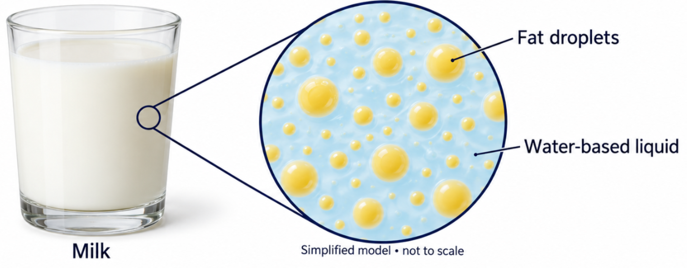
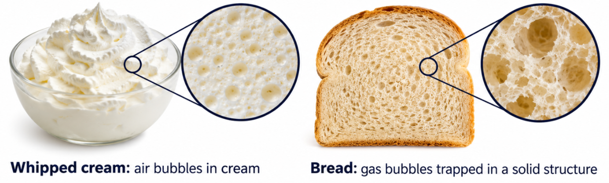
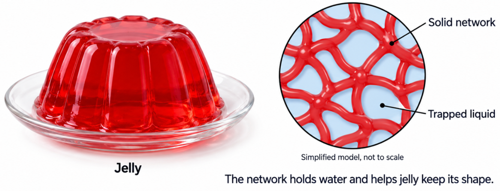
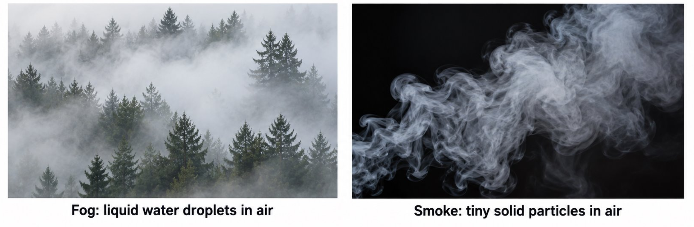

#+title: Colloids
#+author: Justin Guo

A colloid contains tiny undissolved particles or droplets dispered through another substance
- similar to suspension

However, they are small enough to not settle on standing
- turn into sediment and collect at bottom

Colloids often appear homogeneous (uniform) but are technically heterogenous as the substance is not dissolved

* Types of colloids:
- Emulsions
  An emulsion is a colloid of tiny liquid droplets dispered in another liquid

- Foams
  A foam contains gas bubbles dispersed in a liquid or solid

- Gels
  A gel contains liquid trapped within a solid network

- Aerosols
  An aerosol contains liquid droplets or solid particles dispersed in a gas

* Tyndall
The tyndall effect is the scattering of light by particles or droplets in a colloid
Scattered light makes the beam's path visible from the side

