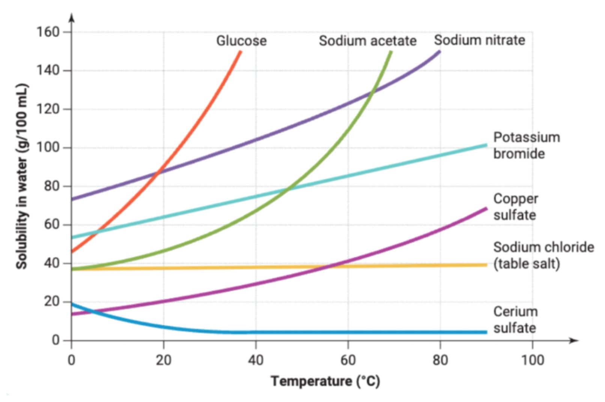

#+title: Solubility
#+author: Justin Guo

* Solubility

Solubility is the quantitative measure of how much of a substance the solvent can dissolve
The solubility of a substance is usually dependent on the temperature,
this is because:
- The energy helps the substance overcome molecular bonds

** Soluble
- A substance is soluble if it can dissolve within another substance.
- The substance is homogeneous (equal throughout)

Below is a graph representing the change in solubility in relation to temp

*** Concentration
A solution can be concentrated if it has a lot of solute compared to solvent or dilute if only a small amount of solute is
- Similar to saturation

The amount of dissolved solute refers to a spectrum of concentration

*** Saturation
- A saturated solution is one that is at its maximum solubility
  - No more solute shall dissolve until solubility increases

- An unsaturated solution can have more solute added as it is not saturated yet

- A supersaturated solutionh is where the solubility is temperarily increasd through the increase of the temperature,
  then adding more solute and slowly, and carefully cooling it so the extra solute remains dissolved.
  This means there is more solute dissolved then there should be at that temperature

** Insoluble
- A substance is insoluble if, when mixed with another substance, its particles stay together
- They are heterogeneous (not equal throughout)
