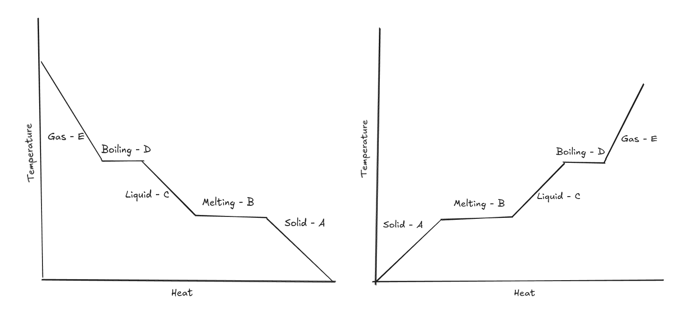

​#Science/Matter The Heating and Cooling curves are when temperatures
plateau at certain points in the process of changing states of matter

Below is a graph of the temperature and change of state:

In the graph to the right, it is evident that the temperature
temporarily stops at point B. This is due to the change of states from
solid to liquid where the atoms are currently absorbing the energy to
change states and weaken the forces of attraction

