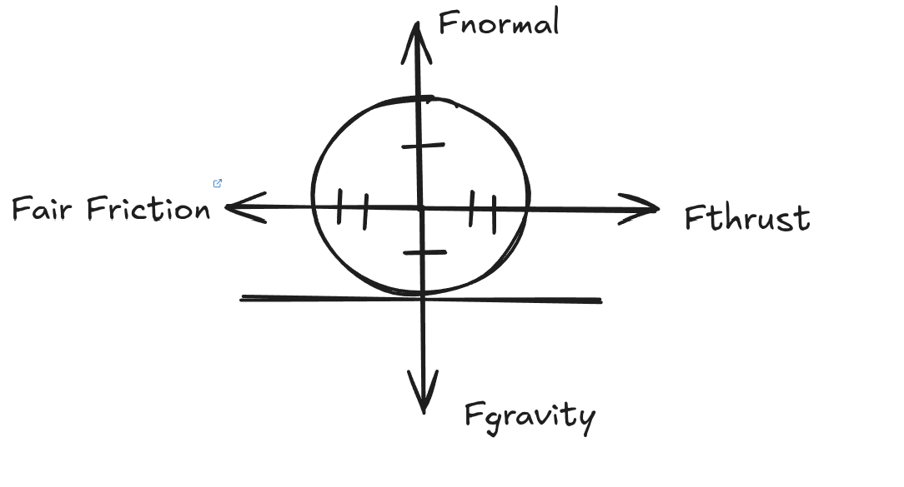
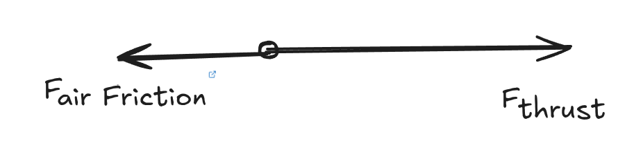
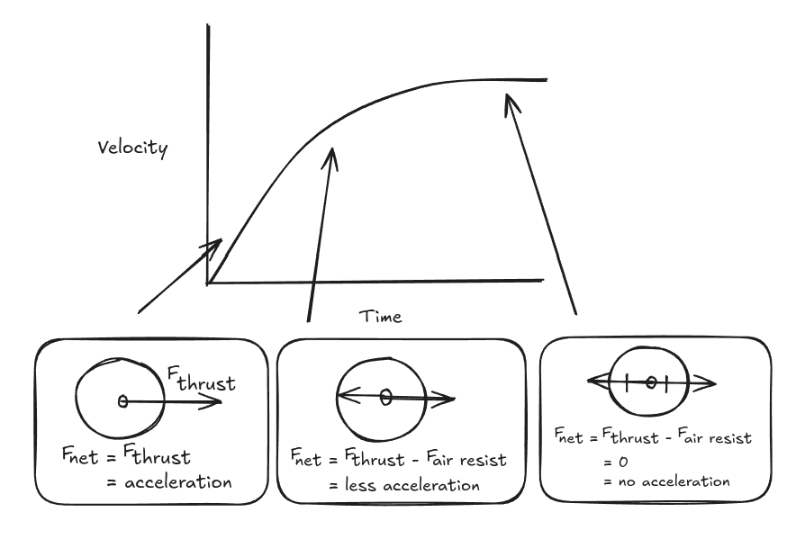

#+TITLE: Forces
#+AUTHOR: Justin Guo

** Main Concept
In physics, a force is an action that results in a change to velocity,
shape, or to resist other forces.

*** Contact Forces
- [[file:./Contact%20Forces/Friction.org][Friction]]
- [[file:./Contact%20Forces/Normal%20Force.org][Normal Force]] 

*** Non-Contact Forces
- [[file:./Non-Contact%20Forces/Magnetism/Magnetism.org][Magnetism]]
- [[file:./Non-Contact%20Forces/Gravity.org][Gravity]]
- [[file:./Non-Contact%20Forces/Electrostatic%20Force.org][Electrostatic Force]]

*** Effects on Motion
Balanced Forces - No change

Unbalanced Forces - Change in velocity or direction

** Examples of forces

As you can see all the forces are equal
\(\therefore F_{net} = 0\)

\(F_{airFriction} < F_{thrust} \therefore acceleration\)

