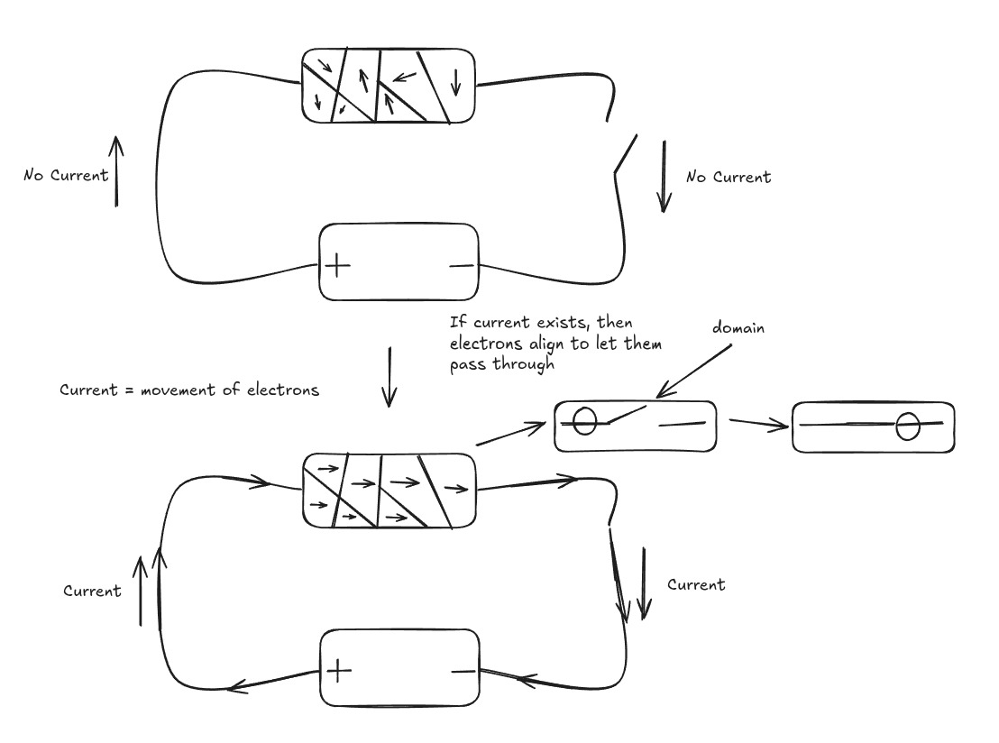

​#Science/Physics/Forces

The 3 main natural magnetic materials are [[Iron]], [[Cobalt]], and
[[Nickel]] When the [[electric]] fields of
[[../../../../Atoms/Electrons.org][Electrons]] align they become
magnetic

*** Electromagnetism
:PROPERTIES:
:CUSTOM_ID: electromagnetism
:END:
When a current is ran through a material, it forces the alignment of
[[../../../../Atoms/Electrons.org][Electrons]] to allow [[electricity]].
However since the [[../../../../Atoms/Electrons.org][Electrons]] become
aligned, it becomes temporarily magnetic.

| Differences                                 | Similarities                                                       |
|---------------------------------------------+--------------------------------------------------------------------|
| Permanent magnets are permanent             | Magnetic                                                           |
| Permanent magnets don't require electrictiy | Attract naturally magnetic materials like Iron, Cobalt, and Nickel |
| Electromagnet strength can be increased     |                                                                    |

