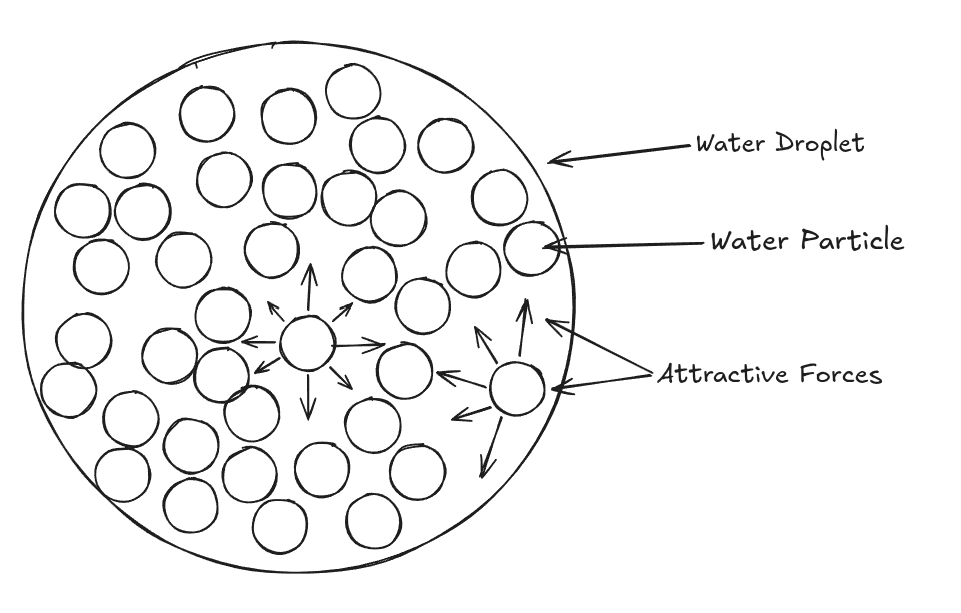

Surface Tension is a physical property that makes the
surface of a liquid act like a stretched, elastic skin, allowing it to
resist external forces
#+end_quote

Explanation Surface tension is caused by the molecular bonds
that hold a substance together. The molecular bonds of the molecules on
the outside can only have downwards and sideways attraction, making
these stronger than molecules on the inside causing the substance to
resist external forces

Below is a diagram illustrating the cause: 
