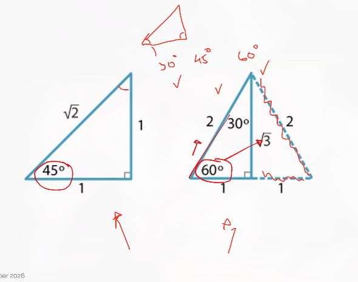

#+TITLE: Todo items
#+SEQ TODO: todo | done

* Habits

Q12
Provided extension explanation and role of photosynthesis and cellular respiration in plants. However, you got the equation for photosynthesis wrong.

Q13.b
Provided 2 differences. However, did not EXPLAIN the differences

Q15
Explained the force being divided over the length of the rope, and provided the formula, Work = Force * Distance. However did not link example to formula

Q16
Explained the greater risk of slipping on a wet tile, rather than the dry tile. However, you did not use data, and did not explicitly name friction, rather stated the lesser force

Q17
Said condensing of balloon air. However, that is not correct. The balloon’s air’s kinetic energy is lessened and therefore, the air particles collide less, and therefore the pressure within the bottle is decreased, causing the volume of the balloon to shrink. Also needed to mention the movement

** TODO Gym                                                           :Daily:
SCHEDULED: <2026-11-04 Wed .+1d>
:PROPERTIES:
:STYLE: habit
:END:

** TODO AIO                                                           :Daily:
SCHEDULED: <2026-11-04 Wed .+1d>
:PROPERTIES:
:STYLE: habit
:END:

* Due work
** TODO Make math notes                                           :Important:
SCHEDULED: <2026-10-27 Tue>

** TODO Try Chaldea (quickshell)

** TODO Try More Agent Skills

** TODO Remember the 30, 45, and 60 deg 

** TODO Trig chapter 23
DEADLINE: <2026-11-06 Fri>
